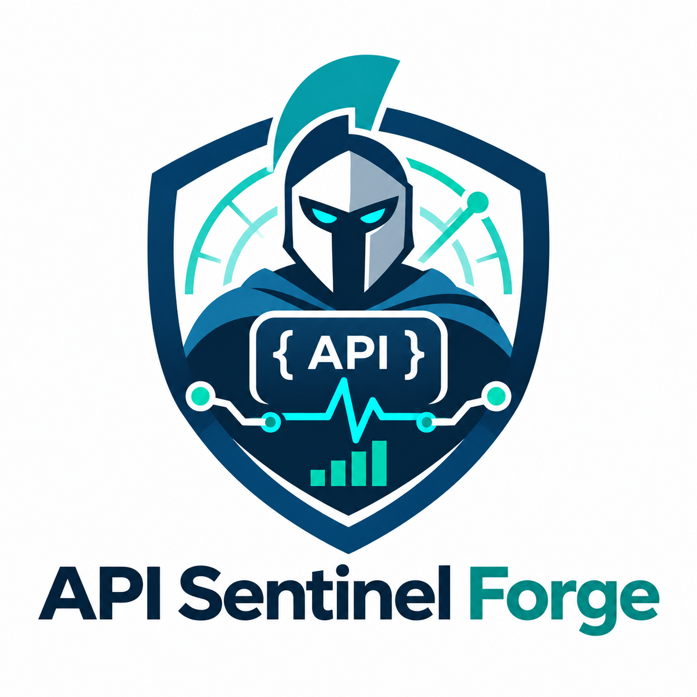

<p align="center">
  
</p>

# API Sentinel Forge

**Observe. Correlate. Diagnose. Verify.**

Local-first API reliability, runtime intelligence and incident investigation —
a specialist in the FORGE ecosystem. It watches how running APIs evolve over
time, turns telemetry into evidence-backed investigations, and delegates
specialized diagnosis to the other Forges instead of re-implementing them.

> Status: **0.1.0 release candidate — Cycles 0–10 consolidated**
> (see `CHANGELOG.md` and `docs/cycles/`). Cycle 10 closed the
> cross-forge homologation loop: real Doctor/Atlas/the-forge
> integrations, Portal `/api-operations` on live Sentinel data,
> hardened `/v1` auth, federated E2E 16/18 (+2 honestly blocked).
> Portuguese README: [`README.pt-BR.md`](README.pt-BR.md).

## What it is (and is not)

| API Sentinel owns | Delegated to other Forges |
| --- | --- |
| API inventory & runtime identity | API engineering → `api-forge` |
| Telemetry ingestion & quality state | Contract/config diagnosis → `forge-doctor-api` |
| SLIs, SLOs, error budgets | Structural code graph → `code-atlas-forge` |
| Deterministic anomaly detection | Routing/governance → `the-forge` |
| Incident lifecycle & evidence | Agent sessions → `forge-agent-bridge` |
| Operations data for the Portal | Agentic tracing → `forge-lens` |

## Install

```bash
# from a checkout
./install.sh            # bash
install.ps1             # powershell
# or directly
pip install api-sentinel-forge
api-sentinel install
```

`api-sentinel install` is a guided setup (profile, workspace scope, Portal
integration when detected). Nothing external is required: the core runs
offline against local files.

## First investigation in three commands

```bash
api-sentinel doctor                 # environment health
api-sentinel status                 # workspace state
api-sentinel capabilities           # what this build actually offers
```

Import telemetry, evaluate an SLO, detect anomalies and serve the local
API — all delivered (Cycles 2–9, hardened in 10):

```bash
api-sentinel ingest --source-id <src> --file ./telemetry.jsonl   # Cycle 2
api-sentinel slo evaluate --slo-id <slo> --window-start <t0> --window-end <t1>  # Cycle 3
api-sentinel detect --service-id <svc> --window-start <t0> --window-end <t1>    # Cycle 4
api-sentinel serve --workspace <ws>                              # /v1 API for the Portal (token-gated)
```

`serve` binds loopback by default and requires a workspace token
(`api-sentinel install` generates one; or `API_SENTINEL_TOKEN`) —
self-declared role headers are rejected (Cycle 10).

## Layout

```
src/api_sentinel/   core package (domain / application / infrastructure / contracts / cli)
contracts/v1/       versioned JSON Schemas of the public envelopes
src/api_sentinel/migrations/  versioned SQLite migrations (packaged)
docs/               Cycle-0 canonical set + ADRs + cycle plans
factory/specs/      executed specs for Cycles 2–10 (loop-factory format)
tests/              unit / contract / integration / security / e2e / fixtures
lab/                sample API + reproducible scenarios (grows per cycle)
```

## Exit codes

| Code | Meaning |
| --- | --- |
| 0 | success |
| 1 | domain/user error |
| 2 | usage error |
| 3 | unexpected internal error |

## License

Apache-2.0 — see `LICENSE`.
# Cycle 10.2 operational status

The local-first recovery and security gates are documented in
[`docs/cycles/cycle-10.2/`](docs/cycles/cycle-10.2/). Use `api-sentinel install`
to create a workspace, `api-sentinel tui` for the terminal dashboard, and
`api-sentinel backup create` / `api-sentinel backup restore --from <dir>` for
verified recovery. Restore refuses an occupied workspace unless `--force` is
explicitly supplied. The current evidence is `CONDITIONAL GO`: optional
Agent Bridge/Lens providers and Linux hosted verification remain named
limitations.
